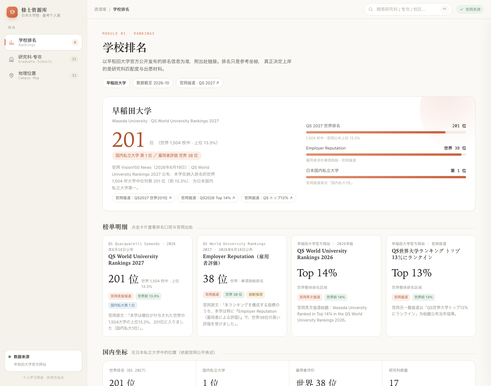
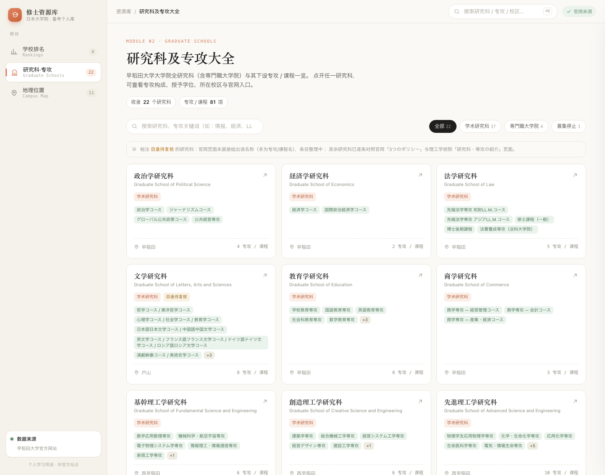
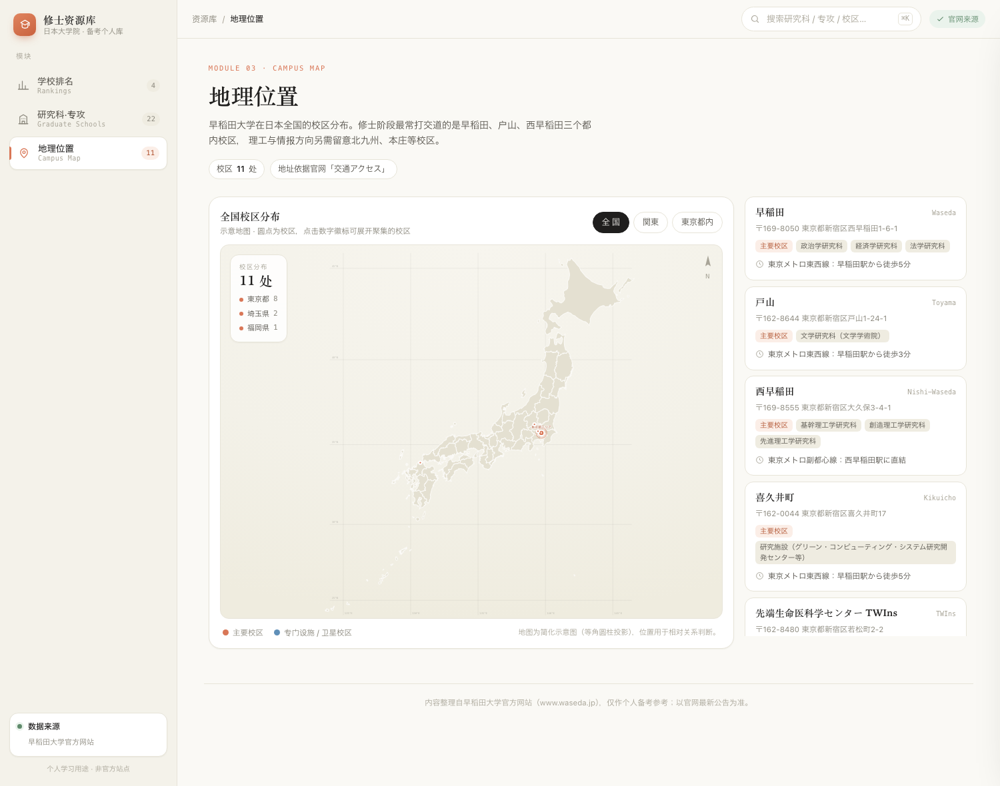

# 日本修士备考 · 个人资源库（Demo）

一个类 Claude 风格的静态站点，用于整理日本大学院（修士）报考所需的院校信息。
**首期只收录早稲田大学**，目前实现三个模块：

**在线预览（GitHub Pages）**：https://zhang-hl-1.github.io/waseda-grad-hub/
<sub>部署后的实际渲染：`preview/07-live-pages.png`（与本地渲染逐字节一致）</sub>





<sub>更多截图：[详情抽屉](preview/04-drawer.png) · [地图放大](preview/05-geo-zoom.png) · [移动端](preview/06-mobile.png)</sub>

| 模块 | 内容 | 数据来源 |
| --- | --- | --- |
| 01 学校排名 | QS 2027 世界 201 位 / 1,504 校中上位 13.3%、雇用者评价世界 38 位、QS 2026 Top 14%、国内私大 1 位 | 早稲田大学官网 Vision150 News、官网英文报道 |
| 02 研究科及专攻大全 | 17 个学术研究科 + 5 个専門職大学院（含募集停止），共 81 条专攻 / 课程；支持搜索、类别筛选、详情抽屉 | 官网「学部・大学院」栏目、各研究科「3つのポリシー」、理工学術院「研究科・専攻の紹介」 |
| 03 地理位置 | 11 处校区 / 设施的全国示意地图＋交通信息；支持全国 / 関東 / 東京都内三级缩放、同区域校区聚合 | 官网「交通アクセス」各校区页面 |

## 运行

```bash
cd waseda-grad-hub
python3 -m http.server 8788 --bind 127.0.0.1
# 浏览器打开 http://127.0.0.1:8788/
```

纯静态，无构建步骤、无外部依赖（字体使用系统字体栈，地图为本地简化后的 SVG 路径数据）。

## 文件结构

```
waseda-grad-hub/
├── index.html                 页面骨架（侧边栏 + 三个模块视图 + 详情抽屉）
├── assets/css/style.css       设计系统：燕麦底色 / 陶土橘 / 衬线标题 / 动效
├── assets/js/data.js          ★ 全部内容数据（排名、研究科、校区）
├── assets/js/map-data.js      日本都道府县简化轮廓（SVG path，墨卡托投影）
└── assets/js/app.js           渲染与交互（视图切换、搜索筛选、抽屉、地图缩放动画）
```

## 功能与动效

- **视图切换**：`#rankings` / `#schools` / `#geo` 三条哈希路由，切换时卡片逐级升入（`--i` 阶梯延迟）。
- **数字动效**：排名数字使用 rAF 缓动计数，进度条宽度过渡；尊重 `prefers-reduced-motion`。
- **研究科大全**：实时关键词搜索（研究科名 / 专攻名 / 学位）+ 类别筛选；卡片网格悬停位移。
- **详情抽屉**：右侧滑入 + 背景虚化，含专攻清单、授予学位、所在校区、复核状态、官网入口；`Esc` 关闭，支持 `?open=<id>` 深链。
- **地图**：自绘日本轮廓 + 经纬网；全国 / 関東 / 東京都内三档视野用 `viewBox` 插值做平滑缩放动画；圆心与文字按视野宽度反算，保持屏幕尺寸恒定；同一视野内重叠校区聚合成「東京都エリア」徽标，点击展开。
- **快捷键**：`⌘K` / `/` 聚焦搜索，`Esc` 关闭抽屉或清空搜索。

## 数据可信度

- 排名模块**只使用官网公开表述与数字**，不做二次换算；每张卡片都带官网出处链接。
- 研究科 / 专攻条目中，凡官网页面没有直接给出该名称的，标记为 `pending: true`（页面显示为橙色「目录待复核」标签），不会伪装成已核实数据。
- 地图为简化示意（道格拉斯-普克简化 + 墨卡托投影），坐标用于判断相对位置，不作导航用途。
- 2026-10 整理；官网更新后请同步修改 `assets/js/data.js`（单一数据源，无需改动渲染代码）。

## 后续可扩展

- 追加其他大学（数据结构已按 `schools[] / campuses[]` 抽象，可直接并入）。
- 排名模块补历年时间轴；研究科模块补入试科目、语言要求、募集要项链接。
- 个人备考进度：书签、出愿倒计时、研究计划书模板。

## 说明与免责

- 个人学习用、**非商业**项目；页面视觉风格参考了 Claude（Anthropic）的配色与排版气质，仅供个人使用，与 Anthropic 无任何关联。
- 内容整理自早稲田大学官方网站，**与早稲田大学无关**，非官方站点；排名、专攻、校区信息请以官网最新公告为准。
- 站点自绘的地图轮廓数据来自 [dataofjapan/land](https://github.com/dataofjapan/land)（CC0），经道格拉斯-普克简化与墨卡托投影后使用。
- 页面未使用任何第三方 CDN / 追踪脚本，全部资源同目录加载。
